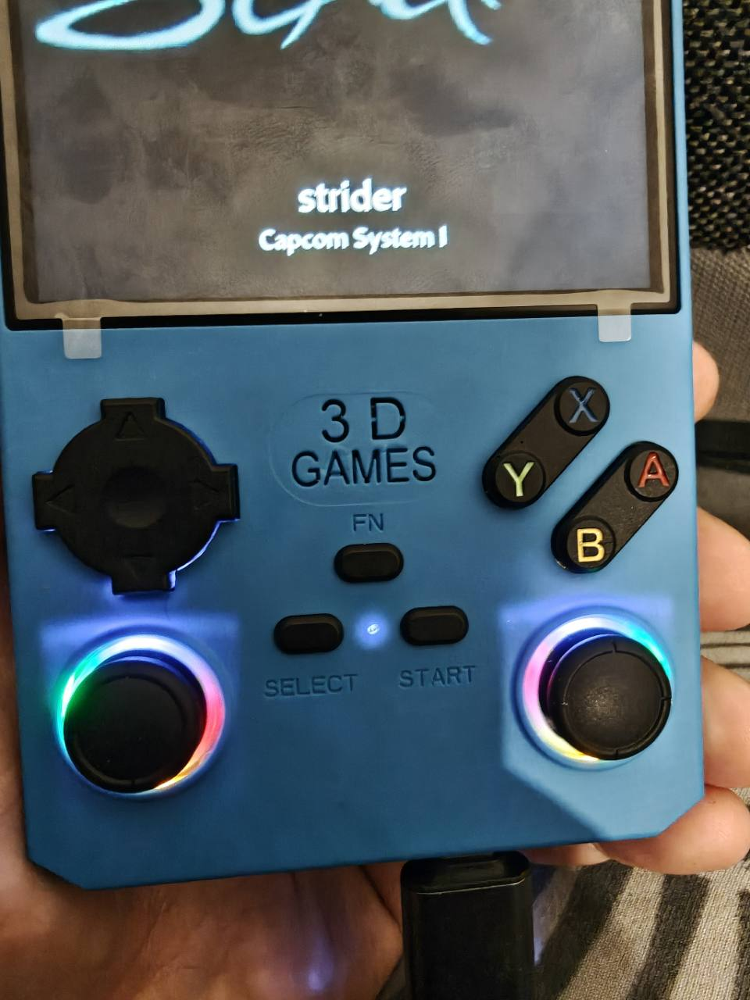

# dArkOS V40 Max

This fork brings ArkOS4Clone’s Debian-based dArkOS userspace to the RK3326 V40 Max with a 720×720 display and **Linux 7.3.4-v40.1**. It includes the V40 panel and controller support, I²S audio clock correction, speaker routing, battery indicators, and RTL8851BU USB Wi-Fi support. The r2 image adds DRM/KMS RetroArch builds, a fixed ARMHF PlayStation core, the standard PPSSPP launch guard, and a title-specific frame-pacing and recompiler profile for PAL Super Mario 64.

Image r3 fixes the Mesa startup failure when launching the verified PAL Super Mario 64 from EmulationStation. Three castle replays on the development card passed at approximately 50 FPS with clean digital audio. [Emulator validation and scope](ports/v40-mainline/EMULATORS.md)

Image r5 gives standalone PPSSPP time to shut down on **SELECT + START**. In two Alien Syndrome tests on the updated V40 Max installation, the game returned to the same responsive EmulationStation process with zero new Panfrost errors. [Image changelog](ports/v40-mainline/CHANGELOG.md#image-revision-734-v401-r5)

For hardware photos and specifications, see the [V40 Max page on Handhelds Wiki](https://handhelds.wiki/V40_MAX).

## Hardware compatibility

| Model | Display | Image support |
| --- | --- | --- |
| V40 Max | 720×720 | Supported. Image r3 was cold-booted and tested on a V40 Max. |
| V40 Pro | 640×480 | Related RK3326 model. A matching U-Boot and Linux panel profile and a hardware cold boot are required before a Pro image can ship. |

See the [V40 Pro hardware specifications](https://dezign-lab.com/product/4-ips-retro-handheld-game-console-v40-pro/) and the [image guide](ports/v40-mainline/IMAGE.md#hardware-compatibility) for boot compatibility.

## Install

- For a fresh SD card, download a [V40 Max image](https://github.com/dev-zetta/darkos-v40-max/releases) and follow the [installation and verification guide](ports/v40-mainline/IMAGE.md). Use a spare card of at least 16 GB.
- For a compatible existing V40 installation, follow the [kernel update instructions](ports/v40-mainline/KERNEL_RELEASE.md). [Download the kernel update](https://github.com/dev-zetta/darkos-v40-max/releases/tag/v40-kernel-7.3.4-v40.1).

See the [V40 port overview](ports/v40-mainline/README.md), [emulator fixes and replay results](ports/v40-mainline/EMULATORS.md), [build instructions](ports/v40-mainline/BUILD.md), and [hardware validation results](ports/v40-mainline/docs/VALIDATION.md). GitHub Actions builds the [full image](https://github.com/dev-zetta/darkos-v40-max/actions/workflows/v40-image.yml) and the [kernel](https://github.com/dev-zetta/darkos-v40-max/actions/workflows/v40-mainline.yml).

## Maintainer

[Gabriel Max](https://github.com/dev-zetta) · [dev@zetta.app](mailto:dev@zetta.app)

See [upstream repositories, source provenance, and credits](ports/v40-mainline/UPSTREAM.md).
